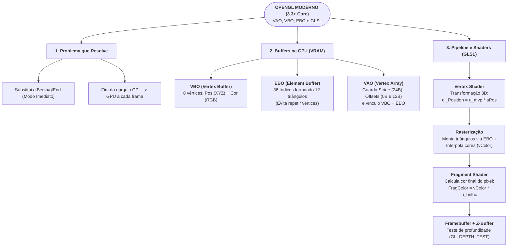

# Guia de Domínio do Código (Checkpoint 4) + Mapa Mental no Papel

Este guia explica de forma direta as linhas essenciais do [`main.py`](file:///home/eduzera/Desktop/Programs/Aula/Grafico/Trabalho/main.py) para que qualquer integrante sorteado na hora saiba responder ao professor com segurança.

---

## 1. Como funciona o `configurar_vao_vbo_ebo()` no `main.py`

### Passo 1: Criar e ativar o VAO
```python
vao = glGenVertexArrays(1)
vbo = glGenBuffers(1)
ebo = glGenBuffers(1)
glBindVertexArray(vao)
```
* **Por que ativar o `vao` primeiro?** Porque o **VAO** grava toda a configuração que vem abaixo dele (qual é o VBO, como ler os bytes de posição/cor e qual é o EBO).

### Passo 2: Enviar os 8 vértices para o VBO e os 36 índices para o EBO
```python
glBindBuffer(GL_ARRAY_BUFFER, vbo)
glBufferData(GL_ARRAY_BUFFER, VERTICES.nbytes, VERTICES, GL_STATIC_DRAW)

glBindBuffer(GL_ELEMENT_ARRAY_BUFFER, ebo)
glBufferData(GL_ELEMENT_ARRAY_BUFFER, INDICES.nbytes, INDICES, GL_STATIC_DRAW)
```
* **`GL_ARRAY_BUFFER` (VBO):** Guarda os dados dos **8 vértices** na GPU (`[X, Y, Z, R, G, B]`).
* **`GL_ELEMENT_ARRAY_BUFFER` (EBO):** Guarda os **36 índices** (12 triângulos $\times$ 3 pontas) na GPU.
* **`GL_STATIC_DRAW`:** Indica que os dados são enviados uma única vez pela CPU e lidos várias vezes pela GPU.

### Passo 3: Explicar para o VAO como ler os bytes do VBO (`stride = 24 bytes`)
Cada linha da matriz `VERTICES` tem **6 números `float32`** (e cada `float32` ocupa **4 bytes** na memória):
$$\text{stride} = 6 \times 4\text{ bytes} = 24\text{ bytes por vértice}$$

```
|------ Posição (12 bytes) ------|-------- Cor (12 bytes) --------|
[    X    ,     Y    ,     Z     ,    R    ,     G    ,     B     ]
^ byte 0                         ^ byte 12                        ^ byte 24 (próximo vértice)
```

Por isso temos apenas **2 atributos**:
1. **Atributo 0 (`aPos` no Vertex Shader):** Lê 3 floats começando no **byte 0**:
   ```python
   glVertexAttribPointer(0, 3, GL_FLOAT, GL_FALSE, 24, ctypes.c_void_p(0))
   glEnableVertexAttribArray(0)
   ```
2. **Atributo 1 (`aColor` no Vertex Shader):** Lê 3 floats começando no **byte 12** ($3 \times 4\text{ bytes}$):
   ```python
   glVertexAttribPointer(1, 3, GL_FLOAT, GL_FALSE, 24, ctypes.c_void_p(12))
   glEnableVertexAttribArray(1)
   ```

### Passo 4: Desenhar no Loop Principal usando o EBO
```python
glBindVertexArray(vao)
glDrawElements(GL_TRIANGLES, triangulos * 3, GL_UNSIGNED_INT, ctypes.c_void_p(0))
```
* **`glDrawElements`** lê os índices do **EBO** e busca os vértices correspondentes no **VBO**!

---

## 2. Perguntas Rápidas que o Professor Pode Fazer

1. **"Por que vocês usaram EBO em vez de só VBO?"**
   * **Resposta:** Porque um cubo tem 12 triângulos (36 pontas), mas apenas **8 cantos físicos**. Sem o EBO (`glDrawArrays`), teríamos que repetir 36 vértices no VBO. Com o EBO (`glDrawElements`), guardamos apenas os **8 vértices únicos** no VBO e passamos 36 índices inteiros.
2. **"Qual a diferença entre `in` (attribute) e `uniform` nos Shaders?"**
   * **Resposta:** As variáveis `in` (`aPos` e `aColor`) vêm do **VBO** e mudam para cada vértice. Já as variáveis `uniform` (`u_mvp` e `u_brilho`) são enviadas pela CPU e têm o mesmo valor para todos os vértices e pixels daquele quadro.
3. **"Como os 8 vértices geram um degradê colorido nas faces do cubo?"**
   * **Resposta:** Na etapa de **Rasterização** (entre o Vertex Shader e o Fragment Shader), a própria GPU faz a **interpolação baricêntrica** da variável `out vec3 vColor` entre os 3 vértices de cada triângulo.

---

## 3. Esquema para o Mapa Mental Individual (Em Papel — Vale 1,0 ponto)


