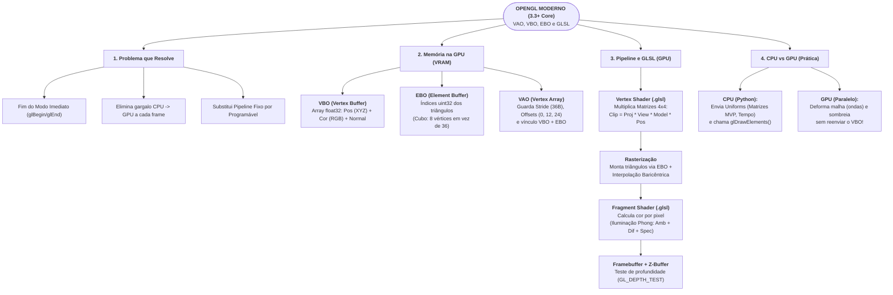

# Guia de Domínio do Código (Checkpoint 4) + Mapa Mental no Papel

Este documento serve para garantir que **todos os integrantes do grupo** dominem 100% do código para o sorteio na hora da apresentação e saibam responder qualquer pergunta do professor.

---

## 1. Explicação Linha por Linha da Função Mais Importante (`criar_vao_vbo_ebo`)

Está em [`main.py`](file:///home/eduzera/Desktop/Programs/Aula/Grafico/Trabalho/main.py#L126-L173). Se você cair no **Bloco 2 ou Bloco 3**, explique exatamente assim:

### Passo A: Criar os IDs na GPU
```python
vao = glGenVertexArrays(1)
vbo = glGenBuffers(1)
ebo = glGenBuffers(1)
```
* **O que faz:** Pede para o driver da placa de vídeo reservar 1 identificador para o **VAO**, 1 para o **VBO** e 1 para o **EBO**.

### Passo B: Ativar o VAO primeiro
```python
glBindVertexArray(vao)
```
* **Por que vem primeiro?** Porque o **VAO** funciona como um "gravador de configuração". A partir do momento em que damos `glBindVertexArray(vao)`, qualquer configuração de atributos do VBO e qualquer vínculo de EBO ficam salvos dentro desse VAO!

### Passo C: Enviar os Vértices para o VBO (CPU $\rightarrow$ GPU)
```python
glBindBuffer(GL_ARRAY_BUFFER, vbo)
glBufferData(GL_ARRAY_BUFFER, vertices.nbytes, vertices, GL_STATIC_DRAW)
```
* **`GL_ARRAY_BUFFER`**: Diz ao OpenGL que `vbo` é um buffer de atributos de vértices.
* **`glBufferData`**: Copia os bytes do array NumPy (`vertices`, que está na memória RAM da CPU) direto para a memória VRAM da GPU.
* **`GL_STATIC_DRAW`**: Dica de desempenho para a GPU dizendo: *"esses vértices serão enviados uma única vez pela CPU e desenhados milhares de vezes pela GPU"*.

### Passo D: Enviar os Índices para o EBO (CPU $\rightarrow$ GPU)
```python
glBindBuffer(GL_ELEMENT_ARRAY_BUFFER, ebo)
glBufferData(GL_ELEMENT_ARRAY_BUFFER, indices.nbytes, indices, GL_STATIC_DRAW)
```
* **`GL_ELEMENT_ARRAY_BUFFER`**: Diz ao OpenGL que `ebo` guarda os **índices** dos triângulos (conectividade da malha). O VAO ativo lembra automaticamente desse EBO!

### Passo E: Explicar para a GPU o Layout de Bytes do VBO (`glVertexAttribPointer`)
No nosso arquivo [`geometria.py`](file:///home/eduzera/Desktop/Programs/Aula/Grafico/Trabalho/geometria.py), cada linha (vértice) tem **9 números `float32`** (cada `float32` ocupa **4 bytes**):
$$\text{stride} = 9 \times 4\text{ bytes} = 36\text{ bytes por vértice}$$

```
|------ Posição (12B) ------|-------- Cor (12B) --------|------ Normal (12B) -------|
[   X   ,    Y   ,    Z     ,    R   ,    G   ,    B    ,   Nx   ,   Ny   ,   Nz    ]
^ byte 0                    ^ byte 12                   ^ byte 24                   ^ byte 36 (próximo vértice)
```

Por isso configuramos os 3 atributos assim:
1. **Atributo 0 (`aPos` no Vertex Shader):** Começa no byte `0`, lê `3` floats e pula de `36` em `36` bytes (`stride`):
   ```python
   glVertexAttribPointer(0, 3, GL_FLOAT, GL_FALSE, 36, ctypes.c_void_p(0))
   glEnableVertexAttribArray(0)
   ```
2. **Atributo 1 (`aColor` no Vertex Shader):** Começa depois dos 3 primeiros floats ($3 \times 4 = 12$ bytes):
   ```python
   glVertexAttribPointer(1, 3, GL_FLOAT, GL_FALSE, 36, ctypes.c_void_p(12))
   glEnableVertexAttribArray(1)
   ```
3. **Atributo 2 (`aNormal` no Vertex Shader):** Começa depois de 6 floats ($6 \times 4 = 24$ bytes):
   ```python
   glVertexAttribPointer(2, 3, GL_FLOAT, GL_FALSE, 36, ctypes.c_void_p(24))
   glEnableVertexAttribArray(2)
   ```

### Passo F: Como a imagem é desenhada no Loop Principal?
```python
glBindVertexArray(vao)
glDrawElements(GL_TRIANGLES, qtd_indices_desenhar, GL_UNSIGNED_INT, ctypes.c_void_p(0))
```
* Em vez de usar `glDrawArrays` (que lê o VBO sequencialmente sem índice), usamos **`glDrawElements`**, que lê as trincas de índices do **EBO** e busca os vértices correspondentes no **VBO**!

---

## 2. Possíveis Perguntas do Professor (e Como Responder na Hora)

1. **"Se eu tirar o EBO, ainda consigo desenhar o cubo?"**
   * **Resposta:** Sim, usando `glDrawArrays(GL_TRIANGLES, 0, 36)`, mas precisaríamos repetir os vértices no VBO totalizando **36 vértices** (6 faces $\times$ 2 triângulos $\times$ 3 vértices). Com o **EBO** e `glDrawElements`, guardamos apenas os **8 vértices únicos** do cubo no VBO e passamos 36 inteiros leves no EBO.
2. **"Qual a diferença entre uma variável `in` (attribute) e uma variável `uniform` no GLSL?"**
   * **Resposta:** As variáveis `in` (`aPos`, `aColor`, `aNormal`) mudam **para cada vértice** lido do VBO. Já as variáveis `uniform` (`u_model`, `u_view`, `u_projection`, `u_time`) são constantes globais enviadas pela CPU que permanecem iguais para todos os vértices e pixels durante aquele comando de desenho.
3. **"Como a cor de apenas 8 vértices vira um degradê suave no meio da face do cubo?"**
   * **Resposta:** Graças à etapa de **Rasterização**! Entre o *Vertex Shader* e o *Fragment Shader*, o hardware da GPU faz a **interpolação baricêntrica** automática das variáveis `out` do Vertex Shader (`vColor`, `vNormal`) para cada pixel gerado dentro do triângulo.
4. **"Quando vocês apertam a tecla `D` e a malha faz ondas, a CPU está recalculando os vértices e reenviando o VBO?"**
   * **Resposta:** Não! O VBO na GPU continua intocado (`GL_STATIC_DRAW`). A CPU envia apenas um único float `u_time` (o relógio), e o **Vertex Shader** na GPU soma $\sin(x + t)$ na coordenada $Y$ de todos os vértices em paralelo.
5. **"Onde entraram as transformações, câmera e projeção que vimos nas aulas?"**
   * **Resposta:** No OpenGL clássico usávamos `glRotatef`, `gluLookAt` e `gluPerspective`. No OpenGL Moderno essas funções fixas não existem mais: nós construímos as matrizes $4 \times 4$ em [`transformacoes.py`](file:///home/eduzera/Desktop/Programs/Aula/Grafico/Trabalho/transformacoes.py) (`u_model`, `u_view` e `u_projection`) e multiplicamos no *Vertex Shader*:
     $$\text{gl\_Position} = \mathbf{P} \cdot \mathbf{V} \cdot \mathbf{M} \cdot \mathbf{v}_{\text{local}}$$

---

## 3. Esquema Pronto para o Mapa Mental Individual (Em Papel — Vale 1,0 ponto)

O mapa mental em papel entregue ao final do seminário deve conter **palavras-chave, setas e pequenos diagramas** (sem copiar textos longos dos slides). Aqui está o esquema ideal para vocês desenharem numa folha A4 deitada:



